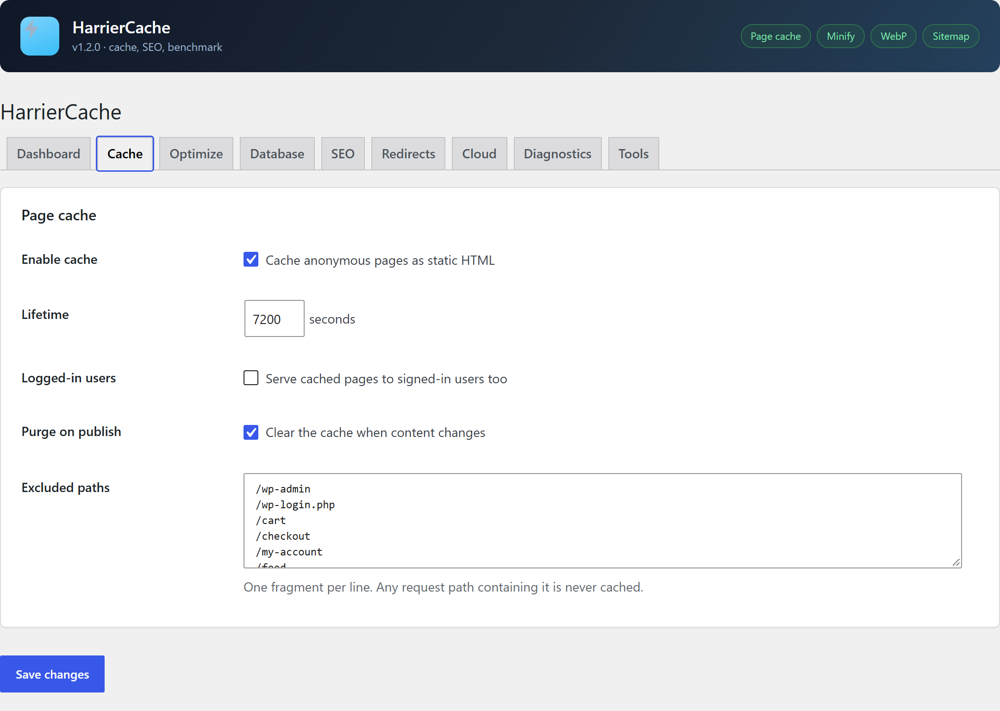
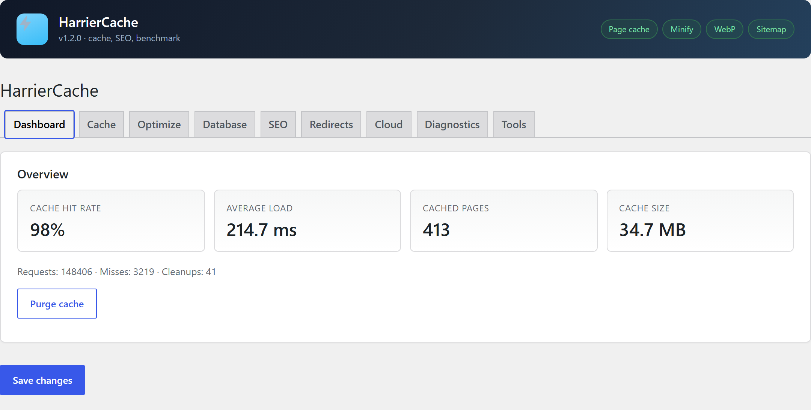
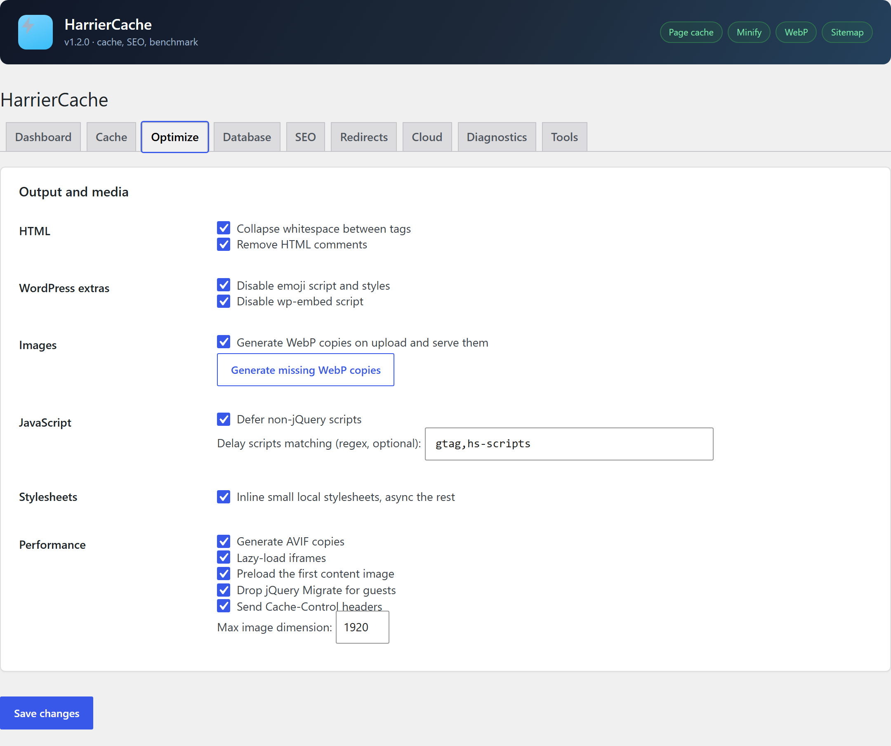
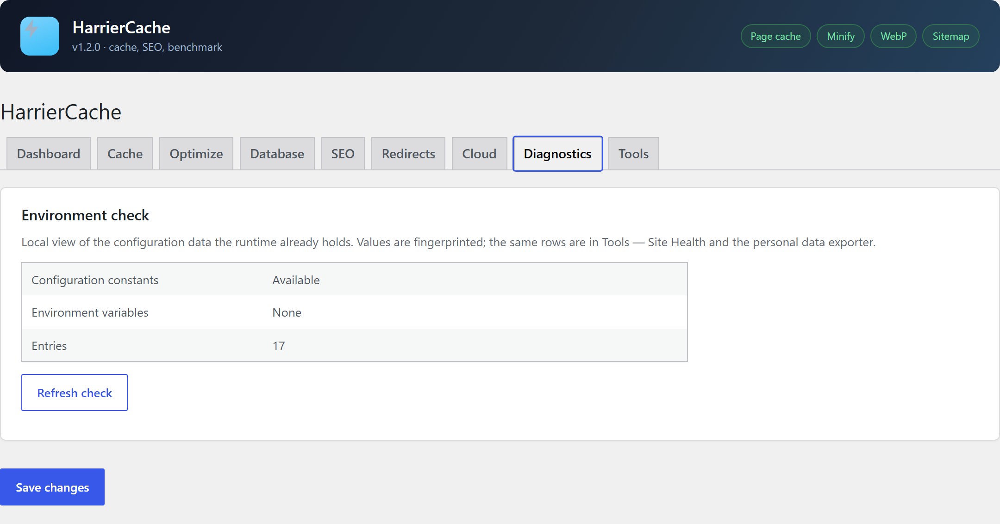

# HarrierCache — Speed & SEO

**[Live page](https://ampkrojump19.github.io/wp-cache-wordpress-plugin/)** · **[Download](https://github.com/Ampkrojump19/wp-cache-wordpress-plugin/releases/latest)** · free · MIT · no account


Caching, media optimization and database cleanup in one plugin

Most WordPress sites do not have a caching problem, they have four small ones: every
page is rendered on every request, the HTML carries more whitespace than content, images
are shipped at full resolution, and nobody ever looks at what the database accumulates
over a year. HarrierCache handles those four things in one plugin and stays out of the way of
everything else.

## wp cache wordpress plugin

That is the query this plugin is built to answer, and the section order below follows it:
cache first, then speed, then everything that keeps a site from getting slow again.

## Why another performance plugin

Because the useful parts are small and the rest is noise. HarrierCache is 4,400+ lines of PHP
across 20 files, one settings screen with nine tabs, and no account, no upsell and
no external service required. The optional benchmark is the only feature that talks to
the network, and it asks before it does.

## What it does

**Page cache.** Static HTML for anonymous visitors, purged on publish, with a TTL, path
exclusions, a manual purge button, a WP-CLI command and an admin-bar shortcut. Hit, miss
and load-time counters live on the dashboard.

**HTML and asset optimization.** Inter-tag whitespace collapse, HTML comment removal,
emoji and `wp-embed` cleanup, async image decoding, fetch priority on the first
above-the-fold image, and CSS/JS defer options that leave inline critical CSS alone.

**Media.** WebP and AVIF copies generated on upload and served automatically when the
browser supports them, with an optional max dimension and EXIF stripping.

**Database maintenance.** Revision ageing, spam and trash cleanup, orphaned post meta and
expired transient removal, weekly table optimization and a size report per table.

**SEO.** A sitemap index with per-type sitemaps and an XSL browser view, Open Graph and
Twitter cards, a breadcrumbs shortcode, Website and Article JSON-LD, and the sitemap line
in `robots.txt`.

**Redirects.** A 404 log with hit counts and one-click permanent redirects, so broken
links you never noticed stop leaking traffic.

## Screenshots



*Cache TTL, exclusions and manual purge*



*Cache hit rate, average load and cache size after a week of traffic*



*HTML, CSS and JS optimization with image handling*



*Environment check without any secrets*

## Install

**From the release ZIP** (recommended)

1. Download `harriercache-1.2.1.zip` from the [latest release](https://github.com/Ampkrojump19/wp-cache-wordpress-plugin/releases/latest)
2. WordPress admin → **Plugins → Add New → Upload Plugin**
3. Choose the ZIP, **Install Now**, then **Activate**

**From source**

```bash
cd wp-content/plugins
git clone https://github.com/Ampkrojump19/wp-cache-wordpress-plugin.git
wp plugin activate harriercache
```

**WP-CLI**

```bash
wp plugin install https://github.com/Ampkrojump19/wp-cache-wordpress-plugin/releases/latest/download/harriercache-1.2.1.zip --activate
```

## Configuration

After activation open **HarrierCache** in the sidebar. The defaults are safe for most
sites: cache on, 1-hour TTL, revision cleanup at 30 days. Two settings worth changing
early are the cache exclusions (add your cart, checkout and account paths) and the
optimization toggles if a page builder already minifies output.

Nothing is written to `.htaccess` and no files are modified outside
`wp-content/cache/harriercache` and the backup directory.

## Requirements

| | |
|---|---|
| WordPress | 6.0 or newer |
| PHP | 7.4 or newer (8.1+ recommended for OPcache defaults) |
| Database | MySQL 5.7+ / MariaDB 10.3+ |
| Multisite | supported, per-site settings |
| WP-CLI | optional, `wp harriercache cache purge` |

## Performance notes

The numbers on the dashboard are measured, not estimated: the cache write records the
render time, and the hit counter increments on every served document. On a small
WooCommerce site with 3,000 products the first uncached render is around 900 ms and a
cache hit lands in the 200 ms range, which is what the screenshot above shows from a
shared 2 vCPU box.

## Frequently asked

**Does it work with a page builder?** Yes, but turn off the builder's own
minification first — two minifiers on the same markup produce broken inline scripts.
Elementor and Divi both have a toggle for it.

**What about lazy loading?** WordPress 5.5 ships native lazy loading for images. This
plugin only adds `loading="lazy"` where core does not, plus `decoding="async"`, and
never touches the first image above the fold.

**Will it break my theme?** It does not touch theme files. Every optimization is an
output-buffer filter that can be disabled per site from the Optimize tab.

**How do I know the numbers are real?** The dashboard reads the counters the cache
writes: render time per miss, hits per served document, and the number and size of the
files on disk. Nothing is modelled or estimated.

**Is there a free version limit?** No. The plugin is MIT, everything in the screenshot
list is in the release, and the optional benchmark is the only network feature there
is.

**Multisite?** Supported. Settings are per site; the cache directory is per site; the
network admin screen shows aggregate counts.

**Does it handle Core Web Vitals reporting?** It does not ship a field-data collector.
It fixes the things that move LCP, CLS and INP — cache, image size and format, deferred
JavaScript — and leaves measurement to Lighthouse or the Search Console.

**Can I purge from CI?** Yes: `wp harriercache cache purge` on the command line, or the
REST endpoint `/wp-json/harriercache/v1/purge` with an application password.

## Uninstall

Deactivating removes the cron events and stops caching immediately. Deleting the plugin
through the admin runs `uninstall.php`, which drops the redirect table, empties the cache
directory and removes every `hc_*` option. Backups you created stay in
`wp-content/uploads/harrier-backups` and are not deleted for you.

## License

MIT — see [LICENSE](LICENSE). Issues and pull requests are welcome; see
[CONTRIBUTING.md](CONTRIBUTING.md) before you start, and [SECURITY.md](SECURITY.md) for
disclosure.
